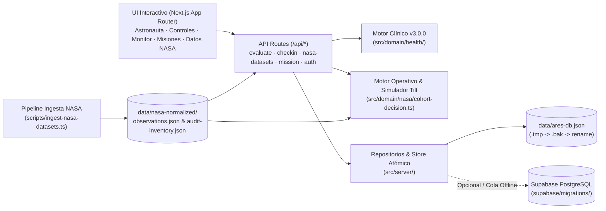

# 🛰️ A.R.E.S. Pulse (ARES Orbit)

**Software modular de autoevaluación médica, triaje espacial y simulación de retorno a gravedad para astronautas**  
*NASA Space Apps Challenge 2026 — Desafío: Health Monitoring Software · Equipo: ApexCode*


---

## 🎯 Visión y Problema que Resuelve

En misiones de larga duración hacia la Luna (Artemis) o Marte, la distancia y el retardo de comunicaciones impiden depender en todo momento de un hospital en Tierra. A partir de los **5 peligros de los vuelos espaciales tripulados de la NASA (HRP)** —radiación espacial, aislamiento, distancia de la Tierra, gravedad alterada y entornos cerrados—, **A.R.E.S. Pulse** ayuda al astronauta a responder en tiempo real tres preguntas operativas críticas:

1. **¿Qué ocurre en mis sistemas fisiológicos?** *(Mente y Sueño, Corazón y Vasos, Energía y Metabolismo, Fiebre e Inmunidad)* aunque solo se hayan medido algunos indicadores.
2. **¿Basta una contramedida a bordo o se requiere intervención del *Flight Surgeon* en Tierra?** *(comparando los signos vitales contra percentiles empíricos de la cohorte NASA y 921 eventos clínicos reales)*.
3. **¿El sistema cardiovascular resistiría hoy el retorno a gravedad o una caminata planetaria (EVA)?** *(proyectando el estrés ortostático real medido en pruebas `Supine → Tilt 80°` de la NASA)*.

---

## ✨ Capacidades Principales

### 1. Motor Clínico Contextual `v3.0.0` (`src/domain/health/`)
- **Telemetría Parcial Honesta (1 a 7 indicadores):** A diferencia de evaluadores rígidos que exigen completar los 7 campos o rellenan huecos con promedios ficticios, evalúa por sistema y reporta **cobertura (`0/7` a `7/7`)**, **calidad de captura** y **sistemas pendientes** sin ocultar alertas activas.
- **Contexto Preanalítico y Postural:** Considera estado de actividad (`rest`, `post_exercise`, `eva`, `orthostatic_tilt`), postura (`supine`, `seated`, `standing_tilt`), ayuno glucémico (`fasting`, `post_meal`, `random`, `unknown`), método térmico, confirmación por lectura repetida y síntomas asociados.
- **Línea Base Personal Causal:** Calcula mediana e IQR históricos (`src/domain/health/baseline-analyzer.ts`) excluyendo episodios previos `RED` para detectar derivas reales sin normalizar patologías persistentes.
- **Trazabilidad de Reglas:** Cada conclusión expone los IDs de regla activados (`ruleTraces`) y la referencia bibliográfica correspondiente.

### 2. Motor de Decisión Operativa NASA en 4 Niveles (`src/domain/nasa/cohort-decision.ts`)
Compara cada medición activa contra las distribuciones empíricas reales de **3,965 observaciones normalizadas de la NASA** (`P5`, `P10`, `P25`, `P50`, `P75`, `P90`, `P95`, `P99`) y cruza la gravedad clínica con los **921 eventos reales de `CRF_C3_SYMPTOMS`** para emitir un dictamen operativo:

| Nivel | Estado Operativo | Criterio Empírico NASA | Acción en Misión |
| :--- | :--- | :--- | :--- |
| 🟢 **Nivel 0** | **Autonomía Total** | Indicadores dentro de banda nominal `P10–P90` de la cohorte espacial | Continuar misión, EVA y retorno autorizados |
| 🔵 **Nivel 1** | **Contramedida Autónoma a Bordo** | Desviación leve/moderada compatible con soporte local (`123` eventos *Nursing* / `220` *Assessment* en `CRF_C3_SYMPTOMS`) | Hidratación, descanso o pausa mental a bordo; reevaluar en 60 min (sin escalar a Tierra) |
| 🟠 **Nivel 2** | **Intervención de Tierra (*Flight Surgeon*)** | Extremos `>P95` / `<P5` o alerta clínica alineada con `268` eventos *Medication* / `26` *Physician Notified* | Bloquear EVA/ejercicio intenso, enviar telemetría a Control de Misión y solicitar protocolo médico |
| 🔴 **Nivel 3** | **Aborto Operativo / Retorno** | Descompensación severa, hipoglucemia crítica (`<55 mg/dL`) o alto riesgo de síncope ortostático al aterrizar | Abortar operación crítica, soporte vital inmediato y evaluar retorno médico |

### 3. Simulador de Retorno a Gravedad / Aterrizaje (`MR001G_C3_TILT`)
Basado en **78 sesiones pareadas `Supine → Standing Tilt (80°)`** (`41` en fase `POST_TEST` post-microgravedad) del estudio oficial **NASA NLSP `MR001G_C3_TILT`**:
- Proyecta **Frecuencia Cardíaca**, **Presión Arterial (PAS/PAD)** y **Presión de Pulso** al pasar de vuelo/reposo a gravedad bajo dos perfiles seleccionables en la UI:
  - **Reentrada Estándar (`P50 POST_TEST`)**: `+60 bpm` FC, `-5 mmHg` PAS, `+6 mmHg` PAD.
  - **Desacondicionamiento Severo (`P75/P25 POST_TEST`)**: `+69 bpm` FC, `-16 mmHg` PAS, `+4 mmHg` PAD.
- Clasifica la aptitud de aterrizaje en: `GO_FOR_LANDING`, `COUNTERMEASURE_REQUIRED_BEFORE_LANDING` o `PRESYNCOPE_ABORT_RISK` (con recomendación de carga salina y traje de compresión anti-G).

### 4. Misiones Diarias Seguras y Modo Replay NASA
- **Bloqueo Clínico de Seguridad (`src/domain/missions/mission-safety.ts`)**: Cuando existe alerta cardiovascular, febril o metabólica activa, el sistema **bloquea automáticamente** la misión de ejercicio extenuante (`0` conflictos ejercicio-alerta sobre las `3,044` observaciones cuantitativas NASA, frente a `110` conflictos en la versión `v2.0.0`).
- **Auditoría y Replay Longitudinal (`/datos-nasa`)**: Permite recorrer las líneas de tiempo reales de los participantes de **SpaceX Inspiration4** (`OSD-575`) y **UTMB Bedrest Campaigns 1 y 3**, cargando cualquier observación real en el astronauta en modo solo lectura.

### 5. Persistencia Atómica y Esquema Supabase (`src/server/`)
- **Almacenamiento Local Seguro (`file-store.ts`)**: Escritura atómica `.tmp` → respaldo `.bak` → `rename`, con bloqueo en memoria (`withDbLock`) para mutaciones concurrentes y recuperación automática ante fallos parciales.
- **Autenticación Robusta (`crypto-auth.ts`)**: Hash de contraseñas con `scrypt` + sal aleatoria y comparación en tiempo constante (`timingSafeEqual`).
- **Sincronización Remota Opcional (`remote-sync.ts` + `supabase/migrations/`)**: Cola offline honesta cuando Supabase no está configurado o faltan tablas, sin ocultar fallos HTTP.

---

## 📚 Datasets Oficiales de la NASA Integrados

El pipeline `scripts/ingest-nasa-datasets.ts` audita **159 archivos CSV** (`17,653` filas crudas) y extrae **3,965 observaciones reales normalizadas** en `data/nasa-normalized/observations.json` **sin imputar ni mezclar variables entre estudios**:

| Estudio / ID Oficial | Sistema | Población | Obs. Válidas | Variables Extraídas | Uso en A.R.E.S. Pulse |
| :--- | :--- | :--- | :---: | :--- | :--- |
| **[OSD-575](https://osdr.nasa.gov/bio/repo/data/studies/OSD-575)** *(LSDS-8)* | NASA OSDR | 4 astronautas **SpaceX Inspiration4** (3 días LEO; `L-92` a `R+194`) | **28** | `glucose` | Referencia de vuelo espacial real e hipoglucemias post-retorno (`36` y `44 mg/dL`) |
| **[CRF_C3_VITALS](https://nlsp.nasa.gov/api/v1/data/datasets/7153409b-d8a3-5a23-b667-9df8a182dfdc/full)** | NASA NLSP | 23 sujetos en análogo `-6° HDT` (UTMB Campaign 3) | **2,450** | `heart_rate`, `bp_systolic`, `bp_diastolic`, `temperature` | Distribución empírica basal en microgravedad (`P5–P99`) |
| **[MR001G_C3_TILT](https://nlsp.nasa.gov/api/v1/data/datasets/f4a134da-7131-55f8-a0a1-e67d56509432/full)** | NASA NLSP | 26 sujetos en prueba ortostática `Supine vs Tilt` | **156** | `heart_rate`, `bp_systolic`, `bp_diastolic` | Modelo de estrés de retorno a gravedad y detección contextual de taquicardia ortostática |
| **[MR010G_C3_LAB](https://nlsp.nasa.gov/api/v1/data/datasets/a36f6361-3492-5590-a675-a0257edf69ac/full)** | NASA NLSP | 31 sujetos con química sanguínea e i-STAT | **220** | `glucose` | Percentiles de glucemia en ayunas vs. aleatoria (excluye falsos positivos de uroanálisis) |
| **[CRF_C3_SYMPTOMS](https://nlsp.nasa.gov/api/v1/data/datasets/625b7cf3-4cef-5983-8ce1-2e33ec807168/full)** | NASA NLSP | 23 sujetos de UTMB Campaign 3 | **921** | Síntomas + intervenciones clínicas reales | Respaldo estadístico de escalamiento (*Observación*, *Enfermería*, *Botiquín*, *Médico en Tierra*) |
| **[BRSMACT_C1_SLEEP](https://nlsp.nasa.gov/api/v1/data/datasets/e26501eb-7d7a-5012-8c8e-c5bdb3eecaf6/full)** | NASA NLSP | 3 sujetos con actigrafía objetiva (UTMB Campaign 1) | **190** | `sleep_hours` | Percentiles objetivos de duración del sueño en misión |

> **Nota sobre caché cruda:** Los 159 CSV originales descargados desde OSDR/NLSP se excluyen del repositorio vía `.gitignore` (`data/nasa-raw/*`) para mantener el repo ligero; pueden re-descargarse y verificarse con SHA-256 ejecutando el script de ingesta.

---

## 🏗️ Arquitectura del Proyecto



### Estructura de Carpetas

```text
├── data/
│   ├── ares-db.json                   # Estado local inicial (bitácora limpia sin vitales inventados)
│   ├── nasa-raw/README.md             # Guía de caché CSV oficial OSDR & NLSP
│   └── nasa-normalized/
│       ├── audit-inventory.json       # Inventario auditado con conteos, hallazgos y SHA-256
│       └── observations.json          # 3,965 observaciones normalizadas sin imputación
├── scripts/                           # Pipeline CLI de descarga, limpieza y normalización NASA
├── src/
│   ├── app/                           # Páginas App Router y endpoints REST (/api/*)
│   ├── components/                    # Vistas modulares (studio/, checkin/, history/, nasa/, wellness/)
│   ├── context/                       # Estado global de sesión, simulación y replay NASA
│   ├── domain/
│   │   ├── health/                    # Evaluador v3.0.0, contexto, calidad, baseline y reglas
│   │   ├── missions/                  # Catálogo de misiones y bloqueos por seguridad clínica
│   │   └── nasa/                      # Benchmark v2 vs v3 y Motor Operativo + Simulador MR001G
│   ├── hooks/                         # Hooks de borrador de check-in y reportes
│   ├── lib/                           # Cliente HTTP tipado
│   └── server/                        # Auth scrypt, repositorios, store atómico y sync Supabase
├── supabase/migrations/               # Esquema PostgreSQL + tabla health_observations
├── tests/                             # Suite de pruebas (dominio, API Next.js y benchmark NASA)
└── entrega/                           # Documentación de postulación, demo y evidencias
```

---

## 🚀 Instalación y Uso Local

### Requisitos
- **Node.js** 20 o superior
- **npm** 10 o superior

### 1. Clonar e instalar dependencias
```bash
git clone https://github.com/luisGCarpio/NasaSapaceAppChallenge.git
cd NasaSapaceAppChallenge
npm install
```

### 2. Iniciar en modo desarrollo
```bash
npm run dev
```
Abre [http://localhost:3000](http://localhost:3000) en tu navegador.

### 3. Rutas principales de la interfaz
- `/` — **Astronauta**: Mapa corporal interactivo, evaluación clínica `v3.0.0`, Dictamen Operativo NASA (`Nivel 0–3`), comparador de percentiles `P10–P90` y Simulador de Retorno a Gravedad (`MR001G_C3_TILT`).
- `/registro` — **Controles del Cuerpo**: Ajuste de los 7 signos vitales (activables/omitibles de forma independiente), contexto de medición y escenarios rápidos.
- `/historial` — **Monitor en Vivo**: Gráficas de tendencia temporal y bitácora de observaciones.
- `/bienestar` — **Misiones de Hoy**: Rutinas gamificadas con XP, racha diaria, pausa de respiración guiada y envío de bitácora a Tierra.
- `/datos-nasa` — **Datos Reales NASA**: Auditoría `v2 vs v3`, tabla de los 6 datasets oficiales y explorador longitudinal para cargar casos reales (`I4-C001..C004`, `C3-*`, `C1G*`) en el astronauta.

---

## 🧪 Pruebas Automatizadas y Verificación

Ejecutar la suite completa (`11` pruebas unitarias e integración):
```bash
npm test
```
Verificación de tipos TypeScript y compilación de producción:
```bash
npx tsc --noEmit
npm run build
```

*(Opcional)* Re-descargar y regenerar los archivos normalizados desde los repositorios oficiales de NASA OSDR y NLSP:
```bash
npx tsx scripts/ingest-nasa-datasets.ts --force
```

---

## 🔌 Endpoints Principales de la API

| Método y Ruta | Descripción |
| :--- | :--- |
| `GET /api/specs` | Versión del algoritmo (`3.0.0`), especificaciones de signos vitales y escenarios de prueba |
| `POST /api/evaluate` | Evalúa vitales parciales + contexto y devuelve `evaluation` + `operationalDecision` |
| `GET / POST /api/checkin` | Obtiene historial/observaciones o guarda una toma real autenticada (bloquea simulaciones) |
| `POST /api/scenario/[id]` | Ejecuta un escenario simulado (`nominal`, `fatigue`, `dehydration`, `illness`, `emergency`, `post_exercise`) |
| `GET /api/nasa-datasets` | Devuelve inventario auditado, métricas de benchmark (`?view=benchmark`) o timeline por sujeto (`?subjectId=...`) |
| `POST /api/mission/complete` · `/reset` | Completa misiones diarias validando restricciones clínicas activas o reinicia el tablero diario |
| `POST /api/comms/log` | Registra un reporte de comunicación hacia Control de Misión en Tierra |
| `POST /api/auth/login` · `/register` · `/logout` | Gestión de sesión con cookies `HttpOnly` y hashes `scrypt` |

---

## ⚠️ Alcance y Aviso Metodológico

**A.R.E.S. Pulse** es un prototipo de investigación y demostración educativa desarrollado para el **NASA Space Apps Challenge 2026**.
- Las distribuciones y umbrales combinan guías públicas de referencia (NASA-STD-3001, HRP, AHA, NIDDK) con estadísticas descriptivas calculadas sobre cohortes de investigación abierta de la NASA (vuelo corto Inspiration4 y análogos terrestres UTMB en reposo prolongado).
- **No constituye un dispositivo médico certificado** ni reemplaza protocolos clínicos reales de evaluación por médicos de vuelo (*Flight Surgeons*).
- La interacción de aviso a Tierra registra el evento localmente en la bitácora del usuario y copia el reporte estructurado; no transmite telemetría real a redes operativas de la NASA.
